# TrustQA

Question answering over your PDFs - digital, scanned and table-heavy - where every answer comes
with **the source document, the PDF page, the exact supporting quote and a verification status**.
TrustQA would rather say "I can't confirm this" (and tell you why) than give a confident wrong answer.

| Status | Meaning |
|---|---|
| **Verified** | every statement of the answer was matched to a quote on the cited page, numbers included |
| **Partially Supported** | an answer was found, but part of it could not be confirmed - the notes say which part |
| **Insufficient Evidence** | no answer is shown, and the reason is given (nothing relevant found, the documents don't say, or nothing could be confirmed) |

Spec: `docs/TrustQA_PRD_6_Pages.pdf` · Build plan and measured notes per phase: `phases.md` ·
Known failures and what was done about them: `failures.md`

## How it works

```mermaid
flowchart LR
    U[PDF upload] --> X{page has a<br/>usable text layer?}
    X -- yes --> T[PyMuPDF text<br/>+ section headings]
    X -- no / garbage --> O[Tesseract OCR<br/>per-word confidence]
    U --> TB[pdfplumber tables<br/>one chunk per row]
    T --> C[sentence chunks<br/>DOC01_P4_C2]
    O --> C
    TB --> C
    C --> I[(MiniLM + FAISS<br/>+ BM25)]
    Q[question] --> R[hybrid retrieval<br/>RRF, entity-scoped]
    I --> R
    R --> G{gate}
    G -- nothing relevant --> IE[Insufficient Evidence<br/>+ reason]
    G --> L[LLM answers ONLY from<br/>passages, cites chunk IDs]
    L --> VER
    VER --> S[status + citations<br/>+ quotes + warnings]
    subgraph VER[verification - plain Python around an LLM judge]
      P1[citations must be retrieved chunks;<br/>doc + page from metadata]
      P2[quote must exist on the cited page<br/>and say what the claim says]
      P3[numbers / units / periods match<br/>the source; calculations in Python]
      P4[cited document is the one<br/>the question is about]
      P5[conflicts across documents,<br/>OCR uncertainty]
    end
```



- **Document names and page numbers always come from the files' metadata, never from the model.**
- Every LLM output (answer, judge verdict, quote, calculation) is a proposal that Python checks.
- Systems compared in the evaluation: **A** plain-text RAG, **B** OCR + plain RAG, **C** TrustQA.

## Setup

### Windows (tested)
1. Install [Tesseract OCR](https://github.com/UB-Mannheim/tesseract/wiki) (UB-Mannheim build).
2. Python 3.11 or 3.12 (faiss / torch wheels):
   ```
   py -3.12 -m venv .venv
   .venv\Scripts\activate
   pip install -r requirements.txt
   pip install -e . --no-deps
   ```
3. LLM, free and local: install [Ollama](https://ollama.com), then `ollama pull qwen2.5:3b`
   (runs on a 4 GB laptop GPU, ~5-15 s per verified answer).
   Optional stronger model: a free key from console.groq.com, then in `.env`:
   `LLM_PROVIDER=groq`, `LLM_MODEL=llama-3.3-70b-versatile`, `GROQ_API_KEY=...`
4. `copy .env.example .env` and set `TESSERACT_CMD` if Tesseract is not on PATH
   (e.g. `C:\Program Files\Tesseract-OCR\tesseract.exe`).
5. `pytest` (all tests run offline with fake models).

### Google Colab
Open `notebooks/trustqa_colab.ipynb` (Runtime -> T4 GPU). It installs Tesseract and Ollama,
downloads public papers (or takes your uploads), and runs processing, questions, the baseline
comparison and optionally the evaluation.

## Quickstart

**Web app** (upload, ask, see the evidence):
```
streamlit run app/streamlit_app.py
```
Each answer shows its status, the reason behind it, numbered sources with their quotes, and an
evidence viewer with the page image (quote highlighted) and, for table answers, the full table
with the cited row marked. "Compare with plain RAG" in the sidebar answers side by side with a
baseline. Re-uploading a processed file is instant (cached by content hash).

**Command line:**
```
python -m trustqa.cli "What nDCG@10 does BM25 achieve on TREC-COVID?"
python -m trustqa.cli "question" --docs a.pdf b.pdf --show-passages --json
python -m trustqa.cli "question" --baseline-b          # plain RAG for comparison
```

**Python:**
```python
from trustqa.corpus import prepare_corpus, system_config
corpus = prepare_corpus(["paper.pdf", "scan.pdf"], system_config("C"))
answer = corpus.ask("What batch size was used?")
print(answer.result.status.value, answer.result.answer)
for c in answer.result.citations:
    print(c.document_name, c.page_number, c.supporting_quote)
```

## Results

<!-- RESULTS:START -->
Measured on the 38-question development set (`eval/dev_questions.jsonl`: direct, table, scanned, multi-document and unanswerable questions over the 4 pilot papers), qwen2.5:3b at temperature 0 for every system, 3 runs each (mean). Generated by `python -m eval.readme_results` from `eval/results/`; plots in `eval/plots/dev_questions/`.

| | A: plain-text RAG | B: OCR + plain RAG | TrustQA v0.4 | **TrustQA (final)** |
|---|---|---|---|---|
| Answer accuracy (LLM judge, answerable questions) (n=36) | 19% | 33% | 41% | 44% |
| Answered (answerable questions) (n=36) | 76% | 89% | 70% | 75% |
| Verified answers that are correct | n/a | n/a | 62% | 70% |
| Shown answers that are wrong | 74% | 62% | 42% | 41% |
| Numeric answers with the right value | 24% | 44% | 51% | 61% |
| Evidence page in the top 5 passages | 56% | 75% | 78% | 83% |
| MRR (first evidence page) | 0.41 | 0.58 | 0.66 | 0.71 |
| Answer cites a labelled evidence page | 55% | 69% | 84% | 96% |
| Unanswerable questions refused (n=2) | 83% | 83% | 100% | 100% |
| Answerable questions refused (n=36) | 24% | 11% | 30% | 25% |
| Mean time per answer (s) | 4.1 | 3.6 | 9.2 | 10.1 |

Baselines A/B never mark an answer Verified (they have no verification). "TrustQA v0.4" is the system as tagged after Phase 5; "final" adds the Phase 6 fixes (section headings, entity-scoped retrieval, document-scope check, quantity-answer rule, numeric quote fallback, citation repair, judge retry for skipped claims, list-aware prompt, gate as a floor) - see `failures.md`.

**Ablations** (one component removed from the final system; change vs final, percentage points):

| removed | accuracy | answered | shown answers wrong | unanswerable refused | evidence in top 5 | cites evidence page |
|---|---|---|---|---|---|---|
| tables | -17 | -14 | +14 | +0 | +0 | +1 |
| support | +4 | +14 | +5 | -50 | +0 | -7 |
| numeric | +0 | +5 | +3 | +0 | +0 | -1 |
| ocr | -17 | -11 | +16 | +0 | -22 | -12 |

Without the support or the numeric check an answer can never be Verified (by design), so Verified-based metrics are not compared for those two.

Run-to-run variation of the final system over 3 runs: accuracy 44%-44%, identical answer and status on 89% of questions.
OCR on the scanned pilot paper: character error rate 5.4%, word error rate 10.5% (9 pages).

Answer accuracy is judged by the same 3B model against the reference answers; it has **not yet been checked against a human** - fill `human_verdict` in `eval/results/dev_questions/spot_check.csv` and run `python -m eval.run_all --report-only`.

**Real-world check** on papers never used during development (DPR and ColBERT, an image-only scanned copy of DPR, and both mixed with the pilot papers; `python -m eval.realworld`, expected answers taken from the PDFs' text):

| system | set | correct | Verified | Verified but wrong | refused correctly |
|---|---|---|---|---|---|
| B: OCR + plain RAG | unseen | 8/14 | 0 | 0 | 3/3 |
| B: OCR + plain RAG | scanned | 3/4 | 0 | 0 | 0/0 |
| B: OCR + plain RAG | mixed | 1/4 | 0 | 0 | 0/0 |
| B: OCR + plain RAG | all | 12/22 | 0 | 0 | 3/3 |
| TrustQA v0.4 | unseen | 9/14 | 6 | 0 | 3/3 |
| TrustQA v0.4 | scanned | 3/4 | 2 | 0 | 0/0 |
| TrustQA v0.4 | mixed | 2/4 | 2 | 0 | 0/0 |
| TrustQA v0.4 | all | 14/22 | 10 | 0 | 3/3 |
| **TrustQA (final)** | unseen | 12/14 | 10 | 1 | 3/3 |
| **TrustQA (final)** | scanned | 3/4 | 3 | 1 | 0/0 |
| **TrustQA (final)** | mixed | 3/4 | 3 | 0 | 0/0 |
| **TrustQA (final)** | all | 18/22 | 16 | 2 | 3/3 |

Every answer, citation and warning is in `eval/results/realworld/results.json`; the Verified-but-wrong cases are analysed in `phases.md` (Phase 6 notes). Baseline B never verifies, so its wrong answers are shown as Partially Supported.
<!-- RESULTS:END -->

## Configuration

All settings live in `.env` (see `.env.example`, every switch is commented). System C uses:
hybrid BM25 + dense retrieval, section headings on chunks, entity-scoped retrieval, the
`grounded-v2` answer prompt, and every verification check including the document-scope check and
the quantity-answer rule. Baselines A/B always run with the frozen Phase 1/2 settings
(`eval/configs/system_A.json`, `system_B.json`), whatever `.env` says.

## Evaluation

```
python -m eval.questions                                  # validate eval/questions.jsonl, category counts
python -m eval.run_all                                    # systems, judge, CER/WER, tables, plots, error dump
python -m eval.run_all --questions eval/dev_questions.jsonl   # the 38-question dev set
python -m eval.run_all --systems C --repeats 3            # run-to-run variance
python -m eval.run_all --judge-provider groq --judge-model llama-3.3-70b-versatile   # stronger judge
python -m eval.run_all --report-only                      # rebuild tables/plots from saved runs
```
LLM outputs are cached by (prompt, model) hash in `eval/cache/`, so a re-run reproduces tables and
plots without model calls. Outputs: `eval/results/<set>/` (`summary.md|json|csv`,
`by_category.csv`, `per_question.csv`, `ocr_quality.json`, `error_analysis.md`, `spot_check.csv`)
and `eval/plots/<set>/`. Metric definitions: `eval/metrics.py`; question schema:
`eval/questions.py`. Answer correctness comes from an LLM judge - fill `human_verdict` in
`spot_check.csv` and re-run `--report-only` to measure how often it agrees with you.

## Limitations

- **Small local model.** qwen2.5:3b is the generator and the support judge: lists can stop early,
  and the judge can misquote (then a correct answer is Partially Supported). A stronger model is a
  `.env` change and should be measured with the same harness.
- **Verified is not "complete" or "true in the world":** it means every statement is backed by a
  quote from the cited page of the right document. Completeness is measured separately (accuracy, F1).
- **Scans:** tested on a synthetic scan (clean, 150 DPI); tables inside scanned pages are read as
  plain text, not rebuilt (failures.md F2).
- **Multi-document questions** still often miss one document's evidence (F12).
- **Evaluation set:** the numbers above are on the 38-question development set, written while
  building the system; the final 50-question set (`eval/questions.jsonl`) is labelled separately.

## Layout
- `src/trustqa/processing` - PDF text, OCR fallback, tables, section headings, chunking
- `src/trustqa/retrieval` - embeddings, FAISS, BM25 hybrid, entity-scoped retrieval
- `src/trustqa/verification` - provenance, claim support, numeric checks, conflicts, OCR, scope, status
- `src/trustqa/corpus.py`, `evidence.py` - document sets and page evidence for the app
- `src/trustqa/pipeline.py` - `answer_question()` integration; `cli.py` command line
- `app/` - Streamlit UI · `eval/` - evaluation harness · `notebooks/` - Colab
- `docs/` - PRD, report outline, demo script · `data/` - PDFs and generated artifacts (git-ignored)
